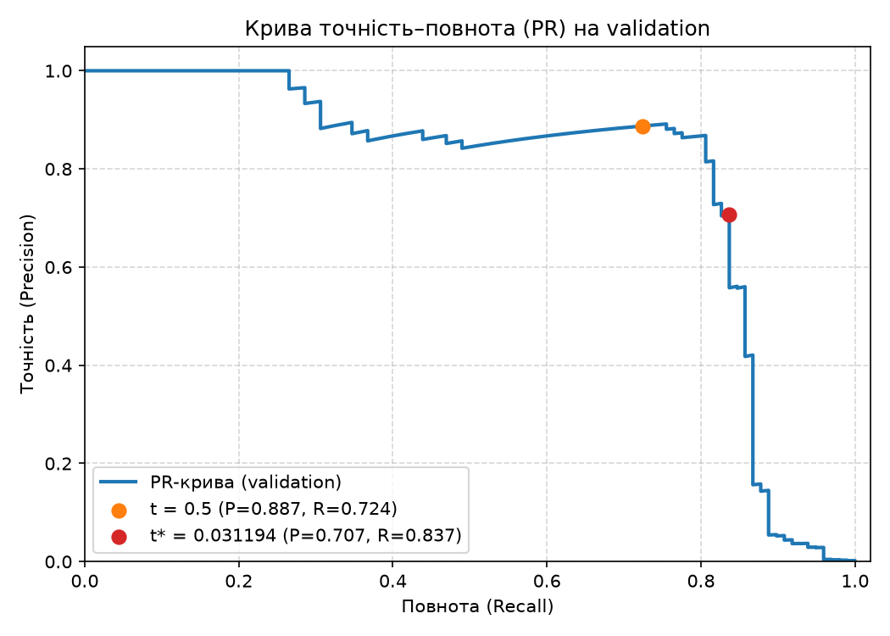
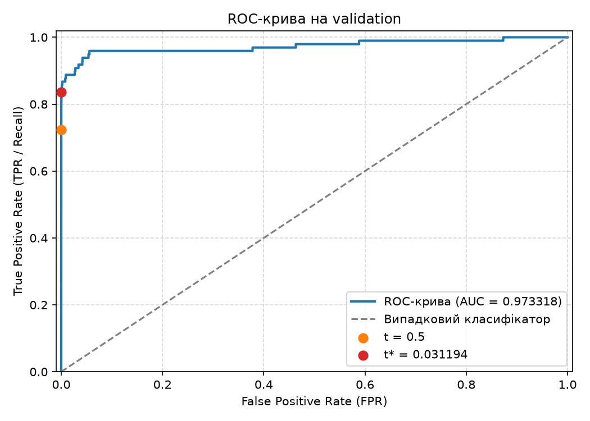

# ЛР2. Поріг рішення під асиметричну ціну помилок

## 1. Мета роботи та вихідні дані

Мета роботи — дослідити вплив вибору порога класифікації $t$ для фіксованої нейронної мережі в задачі виявлення шахрайських транзакцій із сильним дисбалансом класів та асиметричною вартістю помилок.

- **Набір даних:** [Credit Card Fraud Detection (Kaggle)](https://www.kaggle.com/datasets/mlg-ulb/creditcardfraud), файл `creditcard.csv` (284 807 транзакцій, із них 492 шахрайські — $\approx 0.1727\%$).
- **Ознаки:** 29 ознак (`V1`–`V28` та `Amount`). Стовпці `Class` (цільова мітка: `1` — шахрайство, `0` — легітимна транзакція) та `Time` до входу моделі не включалися. Сирі значення `Amount` збережені окремо для аналізу помилок.
- **Файл `creditcard.csv` не додано до репозиторію.** Для повторного навчання його потрібно завантажити з Kaggle (потрібен обліковий запис) і передати шлях до локального файлу через параметр `--data`.

---

## 2. Відтворюваність та команди запуску

Проєкт використовує **Python 3.12** і менеджер пакетів `uv` із зафіксованими версіями залежностей (`pyproject.toml`, `uv.lock`). Усі обчислення моделі виконуються на CPU у `float32`.

Усі команди виконуються з каталогу `lab2/`:

### 1) Навчання моделі з локального `creditcard.csv` (один раз)

```bash
uv run python lab2_starter.py --data /шлях/до/creditcard.csv --out results_repro
```

_(Якщо `creditcard.csv` лежить безпосередньо в папці `lab2/`, достатньо вказати `--data creditcard.csv`. Скрипт захищений від перезапису непорожньої папки `--out`, тому для повторного запуску вкажіть нову теку, наприклад `results_repro`.)_

### 2) Повний аналіз зі збережених прогнозів без навчання і без CSV (пункти 2–4)

```bash
uv run python analyze.py --saved results
```

Команда читає збережені прогнози з `results/predictions.npz`, відтворює таблиці кандидатів, графіки PR/ROC, перевірки A/B/C, оцінку на `test` і таблицю помилок.

### Структура збережених артефактів у `results/`

- `model.pt`, `predictions.npz`, `preprocessing.npz`, `run.json`, `split_summary.csv` — ваги моделі після 12-ї епохи, індекси поділу, мітки, оцінки $s_i$ без округлення та параметри стандартизації.
- `validation_candidates.csv` — повна таблиця всіх 55 993 кандидатів на `validation` (`threshold, TP, FP, FN, TN, C`) без округлення.
- `validation_comparison.csv` — підсумкове порівняння порогів `0.5`, $t^*$ та $+\infty$ на `validation`.
- `pr_curve_validation.png`, `roc_curve_validation.png` — PR- та ROC-криві на `validation`.
- `check_A.csv`, `check_B.csv`, `check_C.csv` — таблиці незалежної перевірки пошуку порога.
- `test_errors_top5.csv` — перші 5 FP і перші 5 FN на `test` за номером рядка CSV.
- `analysis_summary.json` — зафіксований поріг $t^*$ і підсумкові метрики.

---

## 3. Підготовка даних, поділ вибірки та навчання (Пункт 1)

Поділ виконано у пропорції **60 / 20 / 20** зі стратифікацією за `Class` і збереженням початкових індексів рядків CSV: спочатку `train_test_split` із `test_size=0.4`, `stratify=Class`, `random_state=0`, після чого відкладені 40% поділено навпіл (`test_size=0.5`, `random_state=0`) на `validation` і `test`. Балансування класів не застосовувалося.

| Вибірка      | Кількість об'єктів ($n$) | Шахрайські транзакції (`Class = 1`) |      Частка шахрайства |
| :----------- | -----------------------: | ----------------------------------: | ---------------------: |
| `train`      |                  170 884 |                                 295 |     0.001726 (0.1726%) |
| `validation` |                   56 961 |                                  98 |     0.001720 (0.1720%) |
| `test`       |                   56 962 |                                  99 |     0.001738 (0.1738%) |
| **Разом**    |              **284 807** |                             **492** | **0.001727 (0.1727%)** |

### Чому статистики стандартизації не можна обчислювати на всьому наборі?

Якщо обчислити середнє значення $\mu$ та стандартне відхилення $\sigma$ для `StandardScaler` на всьому датасеті до поділу, інформація про розподіл ознак із `validation` та `test` потрапить у процес навчання (`train`). Це створює **витік даних (data leakage)**: модель опосередковано «бачить» статистику майбутніх даних, що робить оцінку якості на `validation` і `test` штучно оптимістичною та нечесною. Тому `StandardScaler` навчається (`fit`) виключно на `train`, а до `validation` і `test` застосовуються (`transform`) ті самі статистики $\mu_{\text{train}}$ і $\sigma_{\text{train}}$.

### Параметри моделі та навчання (фіксовані)

- **Модель:** `Linear(29, 32) -> ReLU -> Linear(32, 1)`, ініціалізація за замовчуванням PyTorch із `torch.manual_seed(0)`.
- **Функція втрат та оптимізатор:** `BCEWithLogitsLoss` (середнє за пакетом, без зважування класів), `Adam` (`lr = 1e-3`).
- **Навчання:** 12 епох на CPU у `float32`, розмір батчу 1024 (останній неповний пакет не відкидався), перемішування на кожній епосі через `np.random.default_rng(0)`. Використано ваги після 12-ї епохи (підсумкова `BCE` на `train`: `0.003383`); вибір епохи за `validation` не проводився.
- **Отримання оцінок:** у режимі `model.eval()` без обчислення градієнтів обчислено $s_i = \text{sigmoid}(z_i)$, де $z_i$ — вихідний логіт.

---

## 4. Вибір порога на валідаційній вибірці (Пункт 2)

### Правило класифікації та формула вартості

Для порога $t$ транзакція класифікується як шахрайська, якщо $s_i \ge t$. Вартість помилок задається асиметрично (пропуск шахрайства в 10 разів дорожчий за хибну тривогу; `Amount` у формулу не входить):

$$C(t) = 10 \cdot FN(t) + FP(t)$$

### Алгоритм пошуку оптимального порога за $O(n \log n)$

Пошук мінімуму $C(t)$ реалізовано у функції `search_threshold_fast()` без повторного проходу по вибірці для кожного порога:

1. Оцінки $s_i$ та мітки $y_i$ сортуються синхронно за спаданням $s_i$ через `np.argsort(..., kind="mergesort")[::-1]` за $O(n \log n)$.
2. За один лінійний прохід $O(n)$ обчислюються кумулятивні суми `cum_tp = np.cumsum(y_sorted)` та `cum_fp = arange(1, n+1) - cum_tp`.
3. **Обробка рівних оцінок:** оскільки правило $s_i \ge t$ гарантує однаковий прогноз для всіх об'єктів із рівним $s_i$, відбираються лише **останні позиції** кожної групи однакових оцінок (`s_sorted[:-1] != s_sorted[1:]` і останній елемент масиву).
4. **Граничні пороги:** на початок списку кандидатів додається $+\infty$ («усі негативні»: $TP = 0, FP = 0, FN = P, TN = N$). Найменша унікальна оцінка природно дає стан «усі позитивні».
5. Для всіх кандидатів векторно обчислюються $FN = P - TP$, $TN = N - FP$ та $C = 10 \cdot FN + FP$.
6. **Розв'язання нічиєї:** оскільки список кандидатів упорядкований строго за спаданням, виклик `np.argmin(C)` повертає перше входження мінімуму, що автоматично відповідає **найбільшому** порогу серед усіх із мінімальною вартістю.

На `validation` проаналізовано **55 993** кандидати (включно з $+\infty$). Повна таблиця збережена у [`results/validation_candidates.csv`](results/validation_candidates.csv).

### Підсумкова таблиця на `validation`

| Правило на validation        |        Поріг |     TP |     FP |     FN |         TN |       C |
| :--------------------------- | -----------: | -----: | -----: | -----: | ---------: | ------: |
| Стандартний поріг            |     0.500000 |     71 |      9 |     27 |     56 854 |     279 |
| **Мінімум вартості ($t^*$)** | **0.031194** | **82** | **34** | **16** | **56 829** | **194** |
| Усі негативні                |    $+\infty$ |      0 |      0 |     98 |     56 863 |     980 |

_Точне значення без округлення:_ $t^* = 0.0311939232$ (збережене у `results/analysis_summary.json`).

### Криві на `validation` та значення ROC-AUC

**Validation ROC-AUC = `0.973318`**





### Чому висока ROC-AUC не гарантує малої вартості помилок чи високого Precision?

1. **Ефект сильного дисбалансу класів на FPR:** вісь X ROC-кривої — це $\text{FPR} = \frac{FP}{FP + TN}$. Через величезну кількість легітимних транзакцій ($TN \approx 56\,863$) навіть сотні хибних тривог ($FP$) дають мізерне значення $\text{FPR} < 0.01$, тому ROC-крива лишається притиснутою до лівого верхнього кута, а ROC-AUC виглядає майже ідеальною (`0.9733`). Водночас для $\text{Precision} = \frac{TP}{TP + FP}$ (де $TN$ відсутнє) і для абсолютної вартості $C = 10\cdot FN + FP$ кожна зайва сотня $FP$ критично погіршує результат.
2. **Незалежність від порога:** ROC-AUC вимірює лише середню якість ранжування оцінок по всіх порогах разом. За однієї й тієї ж ROC-AUC (`0.973318`) вартість помилок радикально залежить від вибору робочої точки: на `validation` вона коливається від `194` (при $t^*$) до `279` (при `0.5`) і `980` (при $+\infty$).

---

## 5. Незалежна перевірка пошуку порога (Пункт 3)

Швидку реалізацію (`search_threshold_fast`) перевірено на трьох малих наборах проти повністю незалежного прямого перебору за правилом $s_i \ge t$ (`search_threshold_naive`). Усі три набори пройдено з **точним збігом** усіх стовпців (`threshold, TP, FP, FN, TN, C`) і обраного порога $t^*$.

### Набір A: $s = [0.9, 0.7, 0.7, 0.4, 0.2, 0.1]$, $y = [0, 1, 0, 1, 0, 0]$

**Обраний поріг:** $t^* = 0.4$, $\min C = 2$.

|     Поріг |    TP |    FP |    FN |    TN |     C |
| --------: | ----: | ----: | ----: | ----: | ----: |
| $+\infty$ |     0 |     0 |     2 |     4 |    20 |
|       0.9 |     0 |     1 |     2 |     3 |    21 |
|       0.7 |     1 |     2 |     1 |     2 |    12 |
|   **0.4** | **2** | **2** | **0** | **2** | **2** |
|       0.2 |     2 |     3 |     0 |     1 |     3 |
|       0.1 |     2 |     4 |     0 |     0 |     4 |

### Набір B: $s = [0.9, 0.6, 0.3]$, $y = [0, 0, 0]$

**Обраний поріг:** $t^* = +\infty$, $\min C = 0$.

|         Поріг |    TP |    FP |    FN |    TN |     C |
| ------------: | ----: | ----: | ----: | ----: | ----: |
| **$+\infty$** | **0** | **0** | **0** | **3** | **0** |
|           0.9 |     0 |     1 |     0 |     2 |     1 |
|           0.6 |     0 |     2 |     0 |     1 |     2 |
|           0.3 |     0 |     3 |     0 |     0 |     3 |

### Набір C: $s = [0.8,\; \underbrace{0.5, \dots, 0.5}_{11},\; 0.2]$, $y = [1,\; 1,\; \underbrace{0, \dots, 0}_{10},\; 0]$

**Обраний поріг:** $t^* = 0.8$, $\min C = 10$.

|     Поріг |    TP |    FP |    FN |     TN |      C |
| --------: | ----: | ----: | ----: | -----: | -----: |
| $+\infty$ |     0 |     0 |     2 |     11 |     20 |
|   **0.8** | **1** | **0** | **1** | **11** | **10** |
|       0.5 |     2 |    10 |     0 |      1 |     10 |
|       0.2 |     2 |    11 |     0 |      0 |     11 |

### Що перевіряє кожен набір?

- **Набір A (рівні оцінки):** дві транзакції мають однакову оцінку `0.7` із різними мітками (`1` і `0`). Перевіряється, що алгоритм не «розрізає» групу рівних оцінок на проміжний неіснуючий стан (`TP=1, FP=1, C=11`), а переводить обидва об'єкти в позитивний клас одночасно (`TP=1, FP=2, C=12`).
- **Набір B (відсутність позитивних міток):** у вибірці немає жодного об'єкта класу `1` ($P = 0$). Перевіряється наявність і коректна обробка граничного порога $+\infty$ («усі негативні»), який єдиний дає нульову вартість $C = 0$.
- **Набір C (нічия за мінімальною вартістю + велика група рівних оцінок):** мінімальна вартість $C = 10$ досягається одразу на двох порогах — `0.8` (`FN=1, FP=0`) та `0.5` (`FN=0, FP=10`). Це перевіряє правило розв'язання нічиєї (обирається **найбільший** поріг `0.8`, а не `0.5`), а також правильне групування 11 однакових оцінок `0.5` (без групування перше `0.5` із міткою `1` помилково дало б фальшиве $C = 0$).

---

## 6. Тестова оцінка та аналіз помилок (Пункт 4)

Після успішного проходження всіх трьох перевірок зафіксований поріг $t^* = 0.0311939232$ застосовано до тестової вибірки `test` без жодного перепідбору.

### Формули метрик

$$\text{precision} = \frac{TP}{TP + FP}, \qquad \text{recall} = \frac{TP}{TP + FN}$$

- Якщо $TP + FP = 0$ (модель не зробила жодного позитивного прогнозу, наприклад при $t = +\infty$), **precision не визначена**, бо немає жодної тривоги, серед яких можна оцінити частку справжніх.
- Якщо $TP + FN = 0$ (у вибірці немає реальних позитивних прикладів, як у наборі B), **recall не визначена**, бо немає жодного шахрайства, частку виявлення якого можна обчислити.

### Результати на `test`

| Поріг                               |     TP |     FP |     FN |         TN |       C |    Precision |       Recall |
| :---------------------------------- | -----: | -----: | -----: | ---------: | ------: | -----------: | -----------: |
| **$t^* = 0.031194$ (зафіксований)** | **80** | **43** | **19** | **56 820** | **233** | **0.650407** | **0.808081** |
| _Довідково: $t = 0.500000$_         |   _71_ |    _8_ |   _28_ |   _56 855_ |   _288_ |   _0.898734_ |   _0.717172_ |

### Перші 5 FP та перші 5 FN на `test` за номером рядка CSV

| Рядок CSV (від 0, без заголовка) | Тип помилки | Мітка | Оцінка $s_i$ | Amount | Відстань $\|s_i - t^*\|$ |
| -------------------------------: | :---------: | ----: | -----------: | -----: | -----------------------: |
|                              460 |     FP      |     0 |     0.196159 |   2.00 |                 0.164965 |
|                             2961 |     FP      |     0 |     0.080961 |   2.49 |                 0.049767 |
|                            10783 |     FP      |     0 |     0.966327 |  89.99 |                 0.935133 |
|                            13405 |     FP      |     0 |     0.932032 |  89.99 |                 0.900838 |
|                            13617 |     FP      |     0 |     0.922762 |  89.99 |                 0.891568 |
|                            10497 |     FN      |     1 |     0.011464 |   3.79 |                 0.019730 |
|                            52521 |     FN      |     1 |     0.006373 | 105.99 |                 0.024821 |
|                            55401 |     FN      |     1 |     0.005642 |   1.00 |                 0.025552 |
|                            91671 |     FN      |     1 |     0.000500 | 290.18 |                 0.030693 |
|                            93486 |     FN      |     1 |     0.018352 |   0.00 |                 0.012842 |

### Порівняння сирого `Amount` і відстані до порога для FP та FN

- **Сирий `Amount`:**
  - У перших 5 FP помітні три схожі транзакції по `89.99` і дві дрібні (`2.00` та `2.49`), що дає медіану `89.99` (середнє `54.89`). Натомість по **всіх 43 FP** на `test` медіана становить лише `2.49` (середнє `110.98`, діапазон `0.00–1000.00`).
  - У перших 5 FN суми мають широкий розкид від `0.00` до `290.18` (медіана `3.79`, середнє `80.19`), а по **всіх 19 FN** — медіана `33.76`, середнє `161.99`, максимум `829.41`. Отже, модель пропускає як дрібні, так і значні за сумою шахрайські транзакції (зокрема тому, що `Amount` не входить у функцію вартості $C$, і пропуск транзакції на `290.18` чи `829.41` штрафується так само, як на `1.00`).
- **Відстань оцінок до порога $|s_i - t^*|$:**
  - Для **FP** розкид відстаней дуже широкий: серед перших 5 прикладів два лежать відносно близько (`0.0498`, `0.1650`), а три — майже на протилежному кінці шкали (`0.8916–0.9351`, тобто модель була впевнена в шахрайстві понад 92%). Водночас по всіх 43 FP медіанна відстань невелика (`0.0250`), тобто більшість додаткових хибних тривог виникли саме поблизу нового низького порога $t^*$.
  - Для **FN** усі відстані малі (`0.0128–0.0307` у перших 5 і медіана `0.0291` по всіх 19), але це насамперед наслідок геометрії шкали ймовірностей: оскільки $t^* \approx 0.0312$, для будь-якого FN ($0 < s_i < t^*$) відстань $|s_i - t^*|$ математично обмежена зверху величиною $0.0312$. При цьому рядок `91671` із $s_i = 0.000500$ насправді є дуже впевненою помилкою моделі (сильно від'ємний логіт), хоча в одиницях імовірності відстань здається малою.
- **Чи можна за десятьма прикладами судити про причину помилок моделі?**
  **Ні.** Десять прикладів, відібраних за першими номерами рядків CSV, є замалою та потенційно зміщеною підвибіркою (наприклад, на початку файлу трапилися три майже однакові FP-транзакції по `89.99`, які спотворили медіану `Amount` з `2.49` до `89.99` і медіану відстані з `0.0250` до `0.8916`). Крім того, ми бачимо лише `Amount` та оцінку $s_i$, але не аналізуємо розподіл анонімізованих ознак `V1`–`V28` і не маємо контексту транзакцій. Для реальної діагностики причин помилок потрібен аналіз усієї множини помилок, важливості ознак і калібрування моделі.

---

## 7. Висновки

1. **Що змінив вибір порога в роботі незмінної моделі?**
   Ваги нейромережі та ранжування транзакцій (ROC-AUC) не змінилися, але зниження порога з `0.5` до $t^* \approx 0.031194$ змістило робочу точку класифікатора в бік вищої чутливості (Recall). Це узгодило правило прийняття рішень із реальною асиметричною вартістю помилок $C(t) = 10 \cdot FN + FP$.
2. **Якою була ціна цього рішення в термінах FP і FN?**
   - На `validation` вдалося зменшити кількість пропущених шахраїв на **11** ($FN$: $27 \to 16$, економія $110$ одиниць вартості) ціною **25** додаткових хибних тривог ($FP$: $9 \to 34$, $+25$ одиниць), що знизило загальну вартість $C$ з `279` до `194` ($-30.5\%$).
   - На `test` кількість пропущених шахраїв зменшилася на **9** ($FN$: $28 \to 19$, Recall зріс із `71.7%` до `80.8%`) ціною **35** додаткових хибних тривог ($FP$: $8 \to 43$, Precision знизився з `89.9%` до `65.0%`), що скоротило вартість $C$ з `288` до `233` ($-19.1\%$).
3. **Чому результат на `validation` не гарантує такого самого виграшу на `test`?**
   Поріг $t^*$ підбирається шляхом точного мінімізування $C(t)$ на скінченній валідаційній вибірці, де всього **98** шахрайських транзакцій. Через малу кількість позитивних прикладів і випадкові коливання між вибірками знайдений мінімум частково підлаштовується під конкретний шум `validation` (ефект оптимістичного зміщення при виборі порога). У нашому експерименті це чітко підтвердилося: на `validation` вартість зменшилася на `85` одиниць (`279 -> 194`), тоді як на `test` виграш виявився меншим — `55` одиниць (`288 -> 233`).

---

## 8. Джерела та використані інструменти

- Стартовий код підготовки даних і навчання моделі: `lab2_starter.py` (наданий викладачем курсу).
- Датасет: Dal Pozzolo et al., _Credit Card Fraud Detection_, Kaggle (`mlg-ulb/creditcardfraud`).
- Документація бібліотек: NumPy, pandas, scikit-learn, PyTorch, Matplotlib.
- Під час структурування коду аналізу (`analyze.py`) та оформлення звіту використовувався генеративний ШІ-асистент (Gemini); усі розрахунки виконано й перевірено локально.
