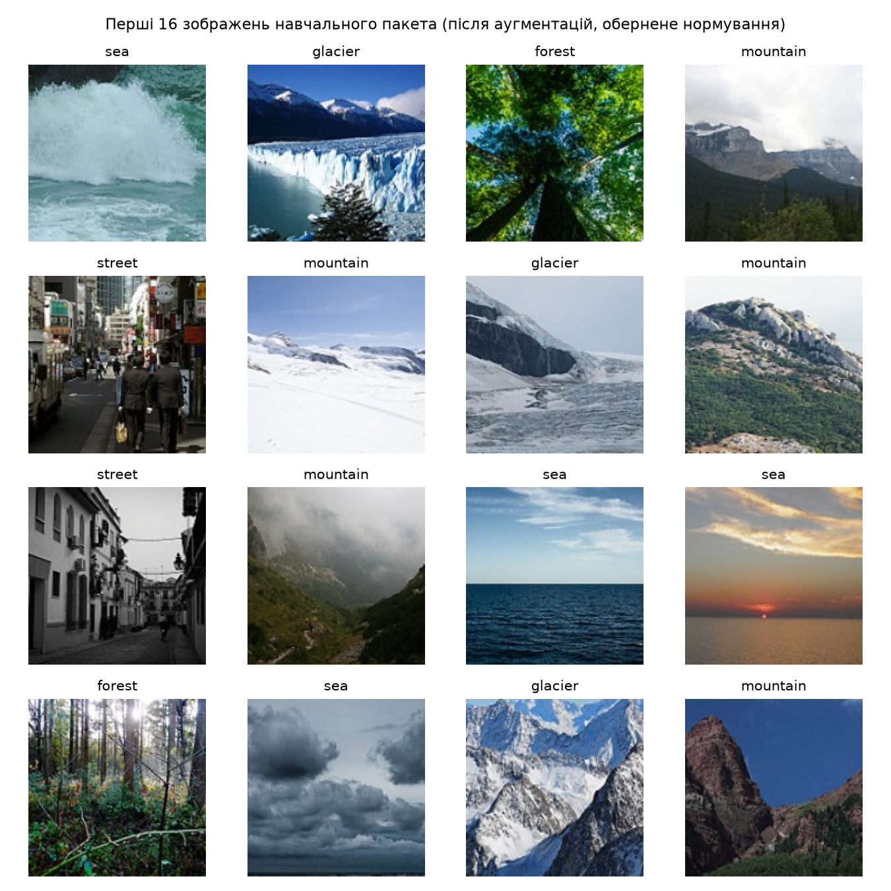
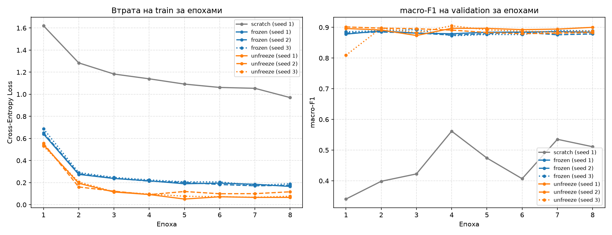
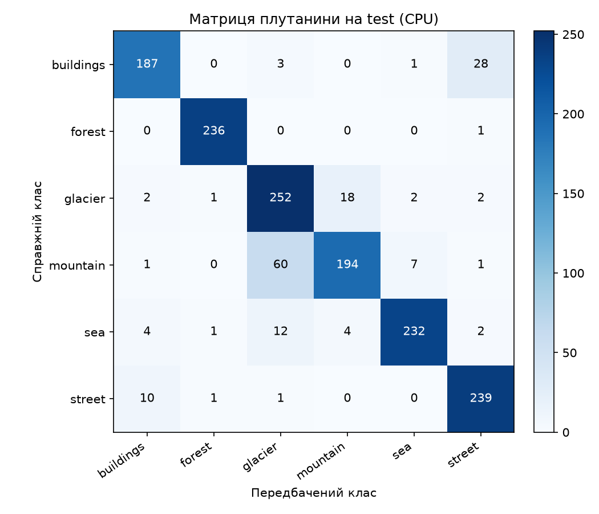
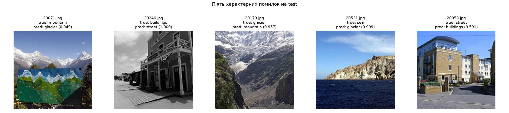

# ЛР3. Обчислювальний експеримент і трансферне навчання

## 1. Мета роботи та вихідні дані

Мета роботи — за фіксованого обчислювального бюджету (8 епох = 304 кроки оптимізатора) порівняти три режими навчання **ResNet-18** на малій вибірці (200 зображень на клас у `train`) і визначити:

1. Яку частину виграшу дають попередньо навчені ознаки ImageNet ($\Delta_{\text{pre}}$).
2. Яку додаткову частину дає донавчання останнього блоку кістяка `layer4` ($\Delta_{\text{unf}}$).
3. Чи перевищує кожна з цих різниць випадковий розкид (шум $R$) між запусками.

- **Набір даних:** [Intel Image Classification (Kaggle)](https://www.kaggle.com/datasets/puneet6060/intel-image-classification), теки `seg_train/seg_train/<клас>/*.jpg` (14 034 зображення) та `seg_test/seg_test/<клас>/*.jpg` (3 000 зображень); тека `seg_pred` не використовувалася.
- **Фіксований порядок класів (0–5):** `buildings`, `forest`, `glacier`, `mountain`, `sea`, `street`.
- **Завантаження зображень:** `Pillow` (`Image.open(...).convert("RGB")`), усі 55 зображень нестандартної висоти збережено і вирівняно перетвореннями.
- **Набір даних не додано до репозиторію.** Для запуску завантажте архів з Kaggle, розпакуйте так, щоб усередині локальної теки (наприклад, `data/`) лежали `seg_train/seg_train/` та `seg_test/seg_test/`, і передайте шлях через `--data`.

---

## 2. Відтворюваність та команди запуску

Проєкт використовує **Python 3.12** і `uv` із зафіксованими залежностями (`pyproject.toml`, `uv.lock`). Навчання виконано у `float32` на `mps`, тестова оцінка — на `cpu`.

Усі команди виконуються з теки `lab3/`:

### 1) Навчання (поділ, перевірки пунктів 1–2, 7 запусків, вибір і збереження `lab3_model.pt`; `test` не використовується)

```bash
uv run python train.py --data /шлях/до/датасету
```

### 2) Аналіз (перевірка SHA-256 `split.csv`, таблиці, криві, ефекти, перевірка вибору, одноразова оцінка `lab3_model.pt` на CPU)

```bash
uv run python analyze.py --data /шлях/до/датасету
```

### Артефакти у репозиторії

- `common.py`, `train.py`, `analyze.py` — код експерименту та аналізу.
- `split.csv` — зафіксований поділ вибірки (`SHA-256`: `b29c53c7e41b0c4bb36e54d8ca3a9bcbac11eca96abeab8ba4fbcf5937a160b8`).
- `runs/<режим>_seed<зерно>/` — журнали `run.json` і логіти `val_logits.npy` ($1498 \times 6$) усіх 7 запусків, а також `checks_summary.json` та `analysis_summary.json`.
- `lab3_model.pt` — ваги та метадані вибраного запуску (`unfreeze`, `seed=1`, `img_size=160`, ~45 МБ; додано безпосередньо в репозиторій для використання в ЛР4).
- `figures/` — `train_batch_sample.png`, `training_curves.png`, `confusion_matrix.png`, `five_errors.png`.

_Примітка щодо git-коміту в журналах:_ усі 7 запусків виконано послідовно в межах одного запуску скрипта на одному стані коду (`git_commit = 4d2659a5`, `git_dirty = true` — запуски проводилися до фінального коміту ЛР3). Відхилень від фіксованих налаштувань протоколу немає.

---

## 3. Перевірки до навчання (Пункт 1)

### Контроль поділу (`split.csv`)

Усі 18 клітинок (кількість файлів / сума числових імен файлів) **точно збіглися** з контрольною таблицею умови. Перевірено, що жоден файл не входить одночасно у дві частини поділу.

| Клас        |                  train |             validation |                   test |
| :---------- | ---------------------: | ---------------------: | ---------------------: |
| `buildings` |        200 / 1 996 761 |        218 / 4 837 323 |        219 / 4 837 559 |
| `forest`    |        200 / 2 032 625 |        237 / 5 276 962 |        237 / 5 291 326 |
| `glacier`   |        200 / 2 183 923 |        276 / 6 135 652 |        277 / 6 157 250 |
| `mountain`  |        200 / 1 950 345 |        262 / 5 789 535 |        263 / 5 849 765 |
| `sea`       |        200 / 1 987 613 |        255 / 5 655 068 |        255 / 5 668 011 |
| `street`    |        200 / 1 841 817 |        250 / 5 541 845 |        251 / 5 547 533 |
| **Разом**   | **1 200 / 11 993 084** | **1 498 / 33 236 385** | **1 502 / 33 351 444** |

### Пакет після перетворень

Для `train` застосовано `RandomResizedCrop(160, scale=(0.7, 1.0)) -> RandomHorizontalFlip() -> ToTensor() -> Normalize(mean, std)`, для `validation`/`test` — `Resize((160, 160)) -> ToTensor() -> Normalize(mean, std)` зі статистиками ImageNet `mean=(0.485, 0.456, 0.406)`, `std=(0.229, 0.224, 0.225)` в усіх режимах.



### Початкова втрата $L_0$ (зерно 1, до жодного кроку оптимізатора)

Орієнтир для рівномірного вгадування на 6 класах: $\ln 6 \approx 1.791759$.

| Режим     |    $L_0$ |  $\ln 6$ | Відхилення ($L_0 - \ln 6$) |
| :-------- | -------: | -------: | -------------------------: |
| `scratch` | 2.047884 | 1.791759 |                  +0.256125 |
| `frozen`  | 1.924394 | 1.791759 |                  +0.132635 |

**Пояснення відхилення:** обидва значення лежать поблизу $\ln 6$, що підтверджує коректність ініціалізації та відсутність критичних помилок у масштабі ознак або функції втрат. Невелике перевищення над `1.792` пояснюється двома причинами: (1) випадкові початкові ваги голови `nn.Linear(512, 6)` створюють ненульові випадкові логіти, а опуклість крос-ентропії робить середню втрату за випадкових логітів трохи вищою за $\ln 6$; (2) оцінка виконана на одному скінченному пакеті з 32 зображень із випадковим балансом класів.

---

## 4. Перевірка режимів навчання та дослід із BatchNorm (Пункт 2)

### Перевірка кількості параметрів (`sum(p.numel())`) і груп AdamW (`weight_decay = 1e-4`)

Перевірено, що всі числа збігаються з таблицею режимів і жоден параметр із `requires_grad=False` не потрапив до оптимізатора:

| Режим      | Усього параметрів | `requires_grad=True` | Групи оптимізатора AdamW (кількість параметрів, `lr`)            |
| :--------- | ----------------: | -------------------: | :--------------------------------------------------------------- |
| `scratch`  |        11 179 590 |           11 179 590 | Уся мережа: `11 179 590` (`lr = 3e-3`)                           |
| `frozen`   |        11 179 590 |                3 078 | `fc`: `3 078` (`lr = 3e-3`)                                      |
| `unfreeze` |        11 179 590 |            8 396 806 | `fc`: `3 078` (`lr = 3e-3`); `layer4`: `8 393 728` (`lr = 3e-4`) |

### Що змінюється за 5 кроків навчання (`set_train_mode`, точне порівняння `torch.equal`)

| Режим      | Модуль   | Параметри змінилися | Ковзні статистики BN змінилися | Збігається з очікуваним |
| :--------- | :------- | :-----------------: | :----------------------------: | :---------------------: |
| `frozen`   | `conv1`  |         ні          |            немає BN            |           так           |
| `frozen`   | `bn1`    |         ні          |               ні               |           так           |
| `frozen`   | `layer1` |         ні          |               ні               |           так           |
| `frozen`   | `layer2` |         ні          |               ні               |           так           |
| `frozen`   | `layer3` |         ні          |               ні               |           так           |
| `frozen`   | `layer4` |         ні          |               ні               |           так           |
| `frozen`   | `fc`     |         так         |            немає BN            |           так           |
| `unfreeze` | `conv1`  |         ні          |            немає BN            |           так           |
| `unfreeze` | `bn1`    |         ні          |               ні               |           так           |
| `unfreeze` | `layer1` |         ні          |               ні               |           так           |
| `unfreeze` | `layer2` |         ні          |               ні               |           так           |
| `unfreeze` | `layer3` |         ні          |               ні               |           так           |
| `unfreeze` | `layer4` |         так         |              так               |           так           |
| `unfreeze` | `fc`     |         так         |            немає BN            |           так           |

### Дослід із навмисною помилкою (`frozen` + `model.train()` замість `set_train_mode`)

- **Прогноз до запуску:** параметри всіх модулів кістяка (`conv1`, `bn1`, `layer1`–`layer4`) залишаться незмінними (бо для них `requires_grad=False` і вони не передані в оптимізатор), а зміняться лише параметри `fc`. Проте в усіх модулях із пакетною нормалізацією (`bn1`, `layer1`–`layer4`) зміняться ковзні буфери `running_mean`, `running_var` і `num_batches_tracked`. Із кривої втрати на `train` цю помилку помітити важко: під час `train()` втрата все одно знижуватиметься, бо `fc` пристосовується до ознак, нормованих поточними батчами.
- **Результат досліду (5 кроків):** прогноз підтвердився повністю:

| Режим                      | Модуль   | Параметри змінилися | Ковзні статистики BN змінилися | Збігається з нормальним `frozen` |
| :------------------------- | :------- | :-----------------: | :----------------------------: | :------------------------------: |
| `frozen` (`model.train()`) | `conv1`  |         ні          |            немає BN            |               так                |
| `frozen` (`model.train()`) | `bn1`    |         ні          |            **так**             |              **ні**              |
| `frozen` (`model.train()`) | `layer1` |         ні          |            **так**             |              **ні**              |
| `frozen` (`model.train()`) | `layer2` |         ні          |            **так**             |              **ні**              |
| `frozen` (`model.train()`) | `layer3` |         ні          |            **так**             |              **ні**              |
| `frozen` (`model.train()`) | `layer4` |         ні          |            **так**             |              **ні**              |
| `frozen` (`model.train()`) | `fc`     |         так         |            немає BN            |               так                |

- Максимальна абсолютна зміна у шарі `layer1.0.bn1` за 5 кроків:
  - max |Δ `running_mean`| = `0.092836`
  - max |Δ `running_var`| = `0.120314`

* Втрата на 5 кроках дійсно знижувалася (`1.8870 -> 1.9456 -> 1.8442 -> 1.6837 -> 1.4074`), маскуючи проблему.
* **Чому `requires_grad=False` не захищає буфери BN:** `requires_grad=False` вимикає лише обчислення градієнтів для навчальних параметрів ($\gamma, \beta$ та ваг згорток). Натомість `running_mean` і `running_var` — це не параметри, а буфери, які оновлюються автоматично під час прямого проходу `forward()` щоразу, коли модуль перебуває в режимі `train()`.
* **Чому для `layer4` у режимі `unfreeze` оновлення статистик BN правильне:** у `unfreeze` ваги згорток усередині `layer4` змінюються, тому змінюється й розподіл активацій перед його шарами BN; старі статистики ImageNet перестають відповідати новим ознакам `layer4`, тож їх необхідно оновлювати разом із навчанням цього блоку.

---

## 5. Сім запусків основного експерименту (Пункт 3)

Метрика якості:

$$
F1_k = \frac{2 \cdot TP_k}{2 \cdot TP_k + FP_k + FN_k}, \qquad \text{macro-F1} = \frac{1}{6}\sum_{k=0}^{5} F1_k
$$

|   # | Режим      | Зерно | Втрата `train`, епоха 8 | `macro-F1 validation`, епоха 8 | Час навчання, с |
| --: | :--------- | ----: | ----------------------: | -----------------------------: | --------------: |
|   1 | `scratch`  |     1 |                0.969895 |                       0.511114 |           49.82 |
|   2 | `frozen`   |     1 |                0.165453 |                       0.884201 |           20.30 |
|   3 | `frozen`   |     2 |                0.175656 |                       0.878500 |           20.13 |
|   4 | `frozen`   |     3 |                0.189583 |                       0.888596 |           19.88 |
|   5 | `unfreeze` |     1 |                0.066237 |                       0.900111 |           24.16 |
|   6 | `unfreeze` |     2 |                0.117126 |                       0.883155 |           24.89 |
|   7 | `unfreeze` |     3 |                0.076798 |                       0.888240 |           24.84 |



---

## 6. Розклад ефектів та аналіз розкиду (Пункт 4)

Формули:

$$
\overline{F}_r = \frac{1}{3}\sum_{s=1}^{3} F_{r,s}, \qquad R_r = \max_s F_{r,s} - \min_s F_{r,s}, \qquad R = \max(R_{\text{frozen}}, R_{\text{unfreeze}})
$$

$$
\Delta_{\text{pre}} = \overline{F}_{\text{frozen}} - F_{\text{scratch},1}, \qquad \Delta_{\text{unf}} = \overline{F}_{\text{unfreeze}} - \overline{F}_{\text{frozen}}
$$

| Величина                                          |               Значення | Інтерпретація                                                                                                     |
| :------------------------------------------------ | ---------------------: | :---------------------------------------------------------------------------------------------------------------- |
| F̄<sub>frozen</sub>, R<sub>frozen</sub>            | `0.883766`, `0.010095` | Розмах 1.01 п.п.                                                                                                  |
| F̄<sub>unfreeze</sub>, R<sub>unfreeze</sub>        | `0.890502`, `0.016956` | Розмах 1.70 п.п.                                                                                                  |
| R = max(R<sub>frozen</sub>, R<sub>unfreeze</sub>) |             `0.016956` | Поріг шуму (1.70 п.п.)                                                                                            |
| Δ<sub>pre</sub>                                   |            `+0.372652` | \|Δ<sub>pre</sub>\| > R (у 22 рази більше за R): ефект вартий перевірки, але формально не доведений цим критерієм |
| Δ<sub>unf</sub>                                   |            `+0.006736` | \|Δ<sub>unf</sub>\| ≤ R (0.40 від R): **різниця не відрізняється від розкиду, результату немає**                  |
| Δ<sub>pre</sub> + Δ<sub>unf</sub>                 |            `+0.379388` | Повний виграш трансферу відносно `scratch`                                                                        |

- **Що змінює зерно (`seed`) і чому розкид у `frozen` і `unfreeze` різний:** у всіх трьох режимах зерно визначає порядок батчів (`shuffle=True`), випадкові аугментації (`RandomResizedCrop`, `RandomHorizontalFlip`) та ініціалізацію голови `fc`. У `scratch` зерно додатково визначає випадкову ініціалізацію всіх 11.18 млн ваг кістяка. У `frozen` оптимізується лише лінійна голова на 3 078 параметрах поверх фіксованих ознак, тому запуски стабільніші ($R_{\text{frozen}} = 0.0101$). У `unfreeze` навчаються 8.40 млн нелінійних параметрів `layer4` + `fc` і оновлюються буфери BN `layer4`, тому траєкторія оптимізації чутливіша до порядку батчів і аугментацій, що дало більший розкид ($R_{\text{unfreeze}} = 0.0170$).
- **Чому $R$ не характеризує розкид запуску 1 (`scratch`) і чи змінює це висновок щодо $\Delta_{\text{pre}}$:** поріг $R$ оцінено на режимах із фіксованим стартом ImageNet, тоді як у `scratch` випадковими є всі ваги мережі з нуля, тож його міжзапускова дисперсія може бути значно вищою. По кривій запуску 1 видно сильні коливання між епохами (від `0.341` на епосі 1 до `0.562` на епосі 4, падіння до `0.407` на епосі 6 і `0.511` на епосі 8 — амплітуда понад 15 п.п.). Однак це **не змінює висновку щодо $\Delta_{\text{pre}}$**: навіть пікове значення `scratch` (`0.562`) відстає від `frozen` (`0.884`) більш ніж на 32 п.п., тобто за бюджету 304 кроки розрив настільки великий, що не може пояснюватися шумом.
- **Чи однаковий бюджет режимів за часом навчання:** за кількістю кроків оптимізатора бюджет однаковий (304 кроки), але **за фактичним часом на `mps` — ні**. Середній час `frozen` становить `20.10 с`, `unfreeze` — `24.63 с` (на ~22% довше), а `scratch` — `49.82 с` (майже у 2.5 рази довше за `frozen`). Причина в тому, що для заморожених шарів PyTorch не виконує зворотний прохід і не оновлює їхні ваги в `AdamW`.

---

## 7. Вибір конфігурації, тестова оцінка та аналіз помилок (Пункт 5)

### Вибір за `validation`

Найбільше середнє F̄<sub>r</sub> отримав режим **`unfreeze`** (`0.890502` проти `0.883766` у `frozen` і `0.511114` у `scratch`), а найкращим серед його запусків став **`seed = 1`** (F<sub>unfreeze, 1</sub> = `0.900111`). Його ваги збережено в `lab3_model.pt`.

> **Важливе застереження:** оскільки $|\Delta_{\text{unf}}| = 0.006736 \le R = 0.016956$, **вибір між `frozen` та `unfreeze` фактично визначив шум**.

### Тестова оцінка `lab3_model.pt` на CPU ($n = 1502$)

- **Test `macro-F1`:** `0.894109`
- **Selected `validation macro-F1` (`unfreeze`, `seed=1`):** `0.900111`
- **Різниця (`test - val`):** `-0.006002` (`-0.60` п.п.)
- **Test `accuracy` ($p$):** `0.892144` (1 340 правильних із 1 502)
- **Стандартна похибка скінченної вибірки:**
  $$SE = \sqrt{\frac{p(1 - p)}{n}} = \sqrt{\frac{0.892144 \cdot 0.107856}{1502}} \approx 0.008004 \text{ (0.80 п.п.)}$$

**Порівняння `test` із `validation` та зміщення вибору:** вибір найкращого з трьох запусків (`0.9001` при середньому `0.8905`) вносить оптимістичне зміщення на `validation`. У наших числах це зміщення помітне за знаком (`test` нижчий на `0.60` п.п.), проте його величина менша за одну стандартну похибку скінченної тестової вибірки ($0.60\text{ п.п.} < 0.80\text{ п.п.}$). Оскільки випадкові коливання через скінченність обох вибірок (`1498` і `1502` зображень) мають порядок `~0.8` п.п. (а для різниці двох незалежних вибірок — ще більше, $\approx \sqrt{2}\,SE \approx 1.1\text{ п.п.}$), оптимістичне зміщення може легко губитися на фоні цього шуму або навіть давати протилежний знак (`test > val`).

### Матриця плутанини $6 \times 6$ на `test` (рядки — справжній клас, стовпці — передбачений)

| Справжній \ Передбачений | `buildings` | `forest` | `glacier` | `mountain` |   `sea` | `street` |
| :----------------------- | ----------: | -------: | --------: | ---------: | ------: | -------: |
| **`buildings`**          |     **187** |        0 |         3 |          0 |       1 |       28 |
| **`forest`**             |           0 |  **236** |         0 |          0 |       0 |        1 |
| **`glacier`**            |           2 |        1 |   **252** |         18 |       2 |        2 |
| **`mountain`**           |           1 |        0 |        60 |    **194** |       7 |        1 |
| **`sea`**                |           4 |        1 |        12 |          4 | **232** |        2 |
| **`street`**             |          10 |        1 |         1 |          0 |       0 |  **239** |



### П'ять характерних помилок на `test`

| Файл        | Справжній клас | Передбачений клас | Імовірність передбаченого класу (`softmax`) | Кількість таких помилок у `test` |
| :---------- | :------------- | :---------------- | ------------------------------------------: | -------------------------------: |
| `20071.jpg` | `mountain`     | `glacier`         |                                      0.9487 |                               60 |
| `20246.jpg` | `buildings`    | `street`          |                                      0.9997 |                               28 |
| `20179.jpg` | `glacier`      | `mountain`        |                                      0.9574 |                               18 |
| `20531.jpg` | `sea`          | `glacier`         |                                      0.9991 |                               12 |
| `20953.jpg` | `street`       | `buildings`       |                                      0.5910 |                               10 |



Плутанина між класами `glacier` і `mountain` (разом `60 + 18 = 78` із `162` усіх помилок, тобто майже половина помилок моделі) є властивістю самого набору даних, де гірські й льодовикові ландшафти часто візуально перекриваються, тому «виправляти» її не потрібно. Класифікація п'яти відібраних зображень:

1. **`20071.jpg` (`mountain -> glacier`, 0.9487):** _сцена містить обидва класи_ — на фото зображені засніжені гірські вершини та щит із їх малюнком, що візуально поєднує ознаки гір і снігово-льодовикового ландшафту.
2. **`20246.jpg` (`buildings -> street`, 0.9997):** _сцена містить обидва класи_ — на передньому плані стоїть фасад будівлі, але кадр знятий вздовж широкого тротуару й вулиці, що йде в перспективу.
3. **`20179.jpg` (`glacier -> mountain`, 0.9574):** _сцена містить обидва класи_ — нижню та середню частину кадру займають круті гірські схили ущелини, а льодовик розташований лише у верхній частині на задньому плані.
4. **`20531.jpg` (`sea -> glacier`, 0.9991):** _помилка моделі на однозначному зображенні_ — на фото чітко показані море та світла прибережна скеля без жодного льодовика, однак яскравий білий колір скелі на фоні синього неба й темної води ввів модель в оману.
5. **`20953.jpg` (`street -> buildings`, 0.5910):** _ймовірна помилка розмітки_ — переважну частину кадру займає великий житловий будинок, тоді як фрагмент під'їзної дороги внизу праворуч має другорядний характер.

---

## 8. Висновок (Пункт 6)

- **Ефект попереднього навчання ($\Delta_{\text{pre}}$):** напрям **позитивний**, величина становить **`+37.27` пунктів `macro-F1`** (`0.8838` у `frozen` проти `0.5111` у `scratch`), що у **22 рази перевищує** поріг розкиду $R = 1.70$ п.п. (`0.372652 > 0.016956`). За конкретного бюджету у **304 кроки** на малій вибірці (200 зображень на клас) основний виграш дають саме готові ознаки ImageNet; за довшого навчання режим `scratch` міг би частково скоротити це відставання.
- **Ефект розморожування кістяка ($\Delta_{\text{unf}}$):** напрям формально **позитивний**, але величина становить лише **`+0.67` пункту `macro-F1`** (`0.8905` у `unfreeze` проти `0.8838` у `frozen`), що **менше за поріг розкиду** $R = 1.70$ п.п. (`0.006736 <= 0.016956`, лише 40% від $R$). За бюджету в **304 кроки** донавчання `layer4` не дало різниці, яку можна відокремити від шуму між запусками, що підтвердилося і на тестовій вибірці (`test macro-F1 = 0.8941` при `SE = 0.80` п.п.).

Для нової задачі з 200 зображеннями на клас за такого ж бюджету я обрав би режим **`frozen`**: він забезпечує майже весь виграш трансферного навчання, має менший розкид між запусками (`1.01` проти `1.70` п.п.) і навчається швидше (`~20.1 с` проти `~24.6 с` в `unfreeze`), не переплачуючи часом і нестабільністю за статистично непідтверджений приріст.

---

## 9. Джерела та використані інструменти

- Датасет: Puneet Bansal, _Intel Image Classification_, Kaggle (`puneet6060/intel-image-classification`).
- Попередньо навчена модель: `torchvision.models.resnet18(weights=ResNet18_Weights.IMAGENET1K_V1)`.
- Документація бібліотек: PyTorch, torchvision, NumPy, scikit-learn, Matplotlib, Pillow.
- Під час написання та структурування коду експерименту (`common.py`, `train.py`, `analyze.py`) й оформлення звіту використовувався генеративний ШІ-асистент (Gemini); усі обчислення, перевірки та аналіз помилок виконано й перевірено локально автором.
